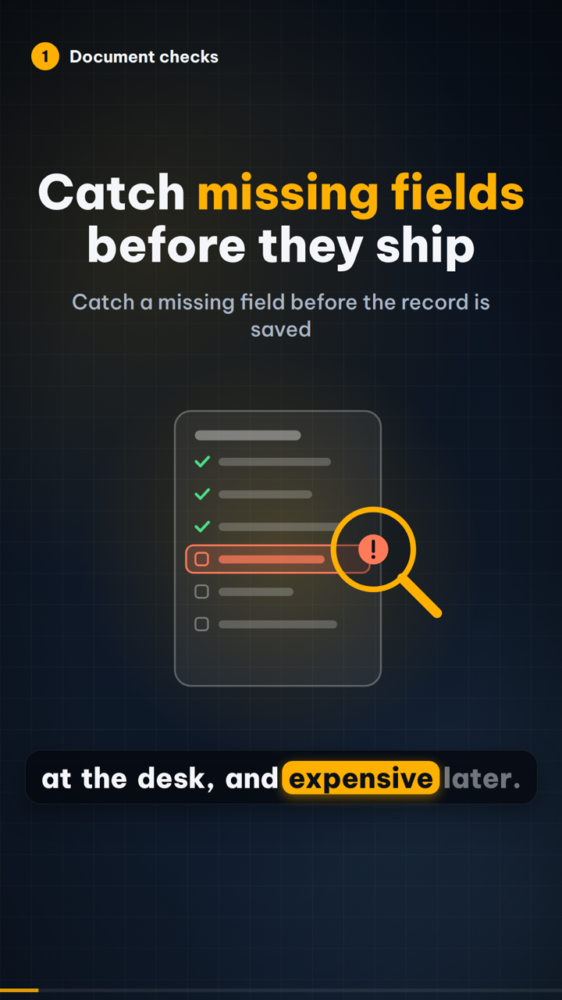
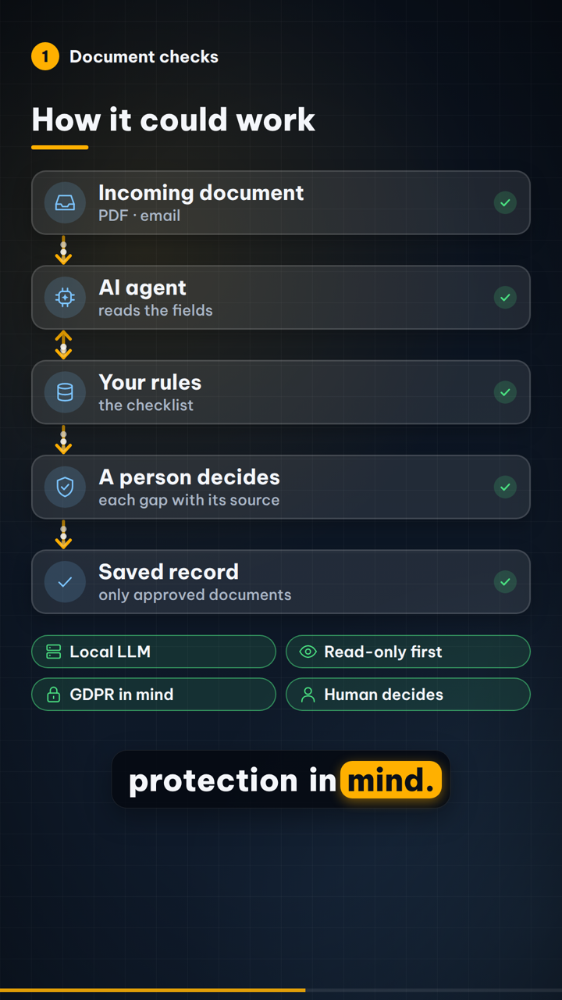
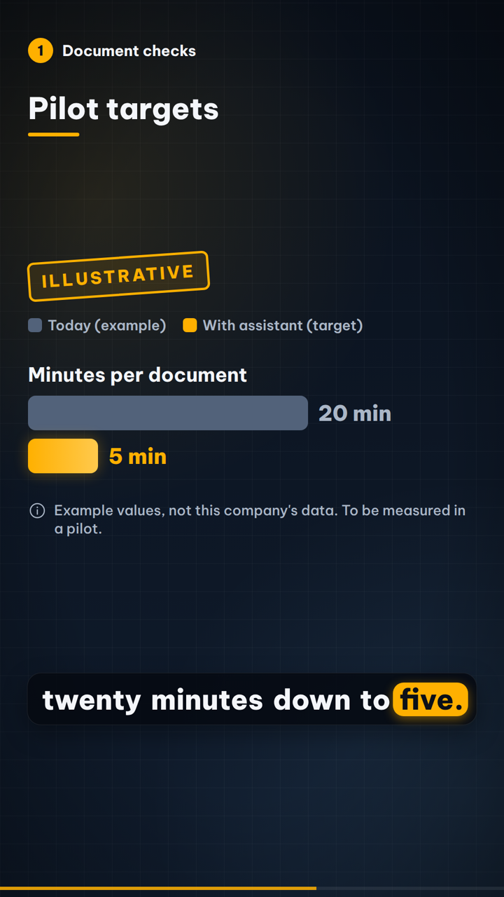
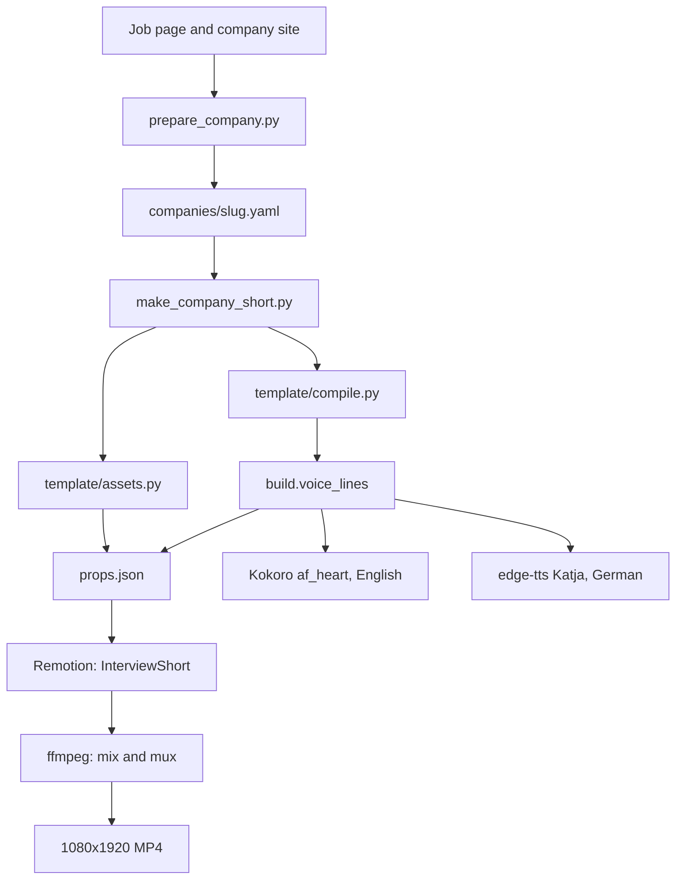

# shorts-studio

A reusable pipeline that turns one company YAML file into a narrated motion-graphics Short, about a minute long, in German or English, with karaoke captions, the company logo and the company's own images.

[](https://www.python.org/)
[](https://www.remotion.dev/)
[](https://www.typescriptlang.org/)
[](LICENSE)

## What it does

You describe one company and one or two problems in YAML. The pipeline compiles that file into a vertical film: a spoken narration, word-timed captions, and a fixed sequence of scenes. A new company does not require a change to the scene code. The name, the logo, the photos and every line come from the config.

Each problem becomes its own 1080×1920 film of about 60–70 seconds. The same config renders in English or German.

The stills below are the neutral example (`companies/_example.yaml`). Its image URLs are placeholders, so the frames use the drawn graphics and a closing card without a logo. No third-party mark is in these pictures.

<p>
  
  
  
</p>

## Architecture



`prepare_company.py` is optional. It fetches a page, caches a logo and up to six images, and writes a draft config. `make_company_short.py` is the render. It compiles the YAML, voices each line, builds Remotion props (scene windows, cue times, karaoke captions), renders the picture, mixes narration with a quiet original music bed, and muxes the file.

## Features

- One YAML file per company. The scenes stay industry-neutral: problem, root cause, solution, flow, result, a proof card, an optional pilot, and a closing card.
- English and German from the same file. English is Kokoro-82M `af_heart`, spoken locally. German is Microsoft `de-DE-KatjaNeural` through `edge-tts`.
- Karaoke captions. The spoken word sits on an amber pill, timed from the speech engine, while the caption keeps the written spelling. A `say` field is what the voice speaks when it would misread a word.
- The company logo is on the closing card only. Photos are credited `Images: <domain>` / `Bilder: <domain>`. A picture that cannot be fetched is dropped, and that scene uses the drawn graphic.
- Before/after numbers are stamped `ILLUSTRATIVE` / `BEISPIELWERTE`. The proof card is fixed in code and cannot be rewritten from the config.
- The closing card says the film is a concept, not an official project, and labels the voice as AI.
- Unchanged lines, images and props are reused. See [Caching](#caching).
- Output is H.264, 1080×1920, 30 fps. The mix is loudness-normalised to −16 LUFS.

## Tech stack

| Piece | Role |
|---|---|
| Python 3 | Compile the config, voice the lines, mix and mux |
| [Remotion](https://www.remotion.dev/) 4.0.534, React 19, TypeScript 5.9 | Draw the scenes and the captions |
| Kokoro-82M `af_heart` | English narration, local |
| `edge-tts` (`de-DE-KatjaNeural`) | German narration |
| ffmpeg | Probe images, mix audio, mux the MP4 |
| PyYAML | Read the config |
| faster-whisper | Word check on the legacy script-pack command, not on every company render |
| Be Vietnam Pro | On-screen type, SIL Open Font License |

## Repository structure

```text
.
├── README.md
├── LICENSE
├── CONTRIBUTING.md
├── docs/                          stills from the neutral example
└── rotpunkt-shorts/
    ├── make_company_short.py      compile, voice, render, mix
    ├── prepare_company.py         optional draft from a page and a site
    ├── companies/
    │   ├── _example.yaml          neutral schema
    │   ├── README.md              worked examples, labelled as concepts
    │   └── rotpunkt/              one worked example: scripts and storyboard
    ├── template/                  compiler, fixed proof card, asset cache
    ├── tools/
    │   ├── setup.sh               fonts, Python env, Remotion browser
    │   └── build.py               speech, render, mix; legacy packs need --pack
    └── video/                     Remotion project (InterviewShort)
```

`studio/`, `content/`, `voice-de/` and `voice-en/` are an earlier assembler for stock-footage explainers. The company Shorts do not use it. Rendered video, review packs and local API config are git-ignored.

## Quickstart

From `rotpunkt-shorts/`. `tools/setup.sh` installs the Be Vietnam Pro fonts, a Python environment at `~/.venvs/kokoro` (override with `KOKORO_VENV`), the packages that environment needs (`torch` CPU, `kokoro`, `soundfile`, `edge-tts`, `faster-whisper`, `pyyaml`), and the Remotion packages pinned in `video/package-lock.json`, including its headless browser. ffmpeg and espeak-ng are installed with apt if they are missing. Node.js and npm need to be on the path already.

```bash
cd rotpunkt-shorts
bash tools/setup.sh
```

Draft a config from a job page and a company site. With no API key this writes a skeleton and saves the fetched text beside it. If `OPENAI_API_KEY` or `ANTHROPIC_API_KEY` is set, one short call fills the story. The keys stay in the environment.

```bash
~/.venvs/kokoro/bin/python prepare_company.py <job_url> --company-site https://example.com
```

Render the neutral example in German. `--lang en` uses Kokoro. A config with two problems renders two films; `--problem <slug>` renders one. `--force` re-voices and re-renders even when nothing changed.

```bash
~/.venvs/kokoro/bin/python make_company_short.py --company-config companies/_example.yaml --lang de
```

The example's logo and photo URLs are `example.invalid`, so they are skipped. The film still renders, with drawn scenes and a wordmark-free closing card. The MP4 is written under `work/companies/example/document-checks/de/`, which is git-ignored.

The first English render downloads the Kokoro-82M weights. German narration calls the Edge read-aloud service, so that path needs a network.

## Config example

The full neutral file is [`rotpunkt-shorts/companies/_example.yaml`](rotpunkt-shorts/companies/_example.yaml). This is its opening:

```yaml
version: 1
company:
  slug: example
  name: Example
  domain: example.invalid
  logo_url: https://example.invalid/logo.svg
  logo_plate: light
  images:
    problem: https://example.invalid/problem.jpg
    cause: https://example.invalid/cause.jpg
    solution: https://example.invalid/solution.jpg

problems:
  - slug: document-checks
    title: {en: Document checks, de: Dokumentenprüfung}
    hook:
      icon: order
      image: problem
      sub:
        en: Catch a missing field before the record is saved
        de: Ein fehlendes Feld finden, bevor der Vorgang gespeichert wird
      en:
        - [{text: "Catch "}, {text: "missing fields", accent: true}]
        - ["before they ship"]
      de:
        - [{text: "Lücken", accent: true}, {text: " finden,"}]
        - ["bevor sie teuer werden"]
```

The same file continues with the root-cause chart, the solution, three to five flow nodes, one or two before/after rows, an optional pilot, and the narration. A spoken line looks like this:

```yaml
- {scene: hook, text: "A missing field is cheap at the desk, and expensive later."}
```

A German line can add `say` when the voice would misread the written words. The caption stays on `text`. From the same file:

```yaml
- {scene: arch, text: "Ein KI-Agent prüft die Felder gegen Ihre Regeln.",
   say: "Ein K-I-Agent prüft die Felder gegen Ihre Regeln.",
   cues: {arch.agent: KI-Agent, arch.rules: Regeln}}
```

The schema, the icon names and the cue rules are in [`rotpunkt-shorts/template/README.md`](rotpunkt-shorts/template/README.md).

## Caching

Nothing is re-voiced or re-rendered when the inputs have not changed.

| What | Where | When it is reused |
|---|---|---|
| Logo and photos | `rotpunkt-shorts/work/asset-cache/`, named by a hash of the URL | The file is already there and at least 400 bytes. A failed download is retried once, including a retry when the site's certificate chain is incomplete. `local:companies/logos/mark.svg` copies a file from the repo instead. |
| One spoken line | `work/voice-cache/<hash>.wav` and a sidecar `.json` | The engine, the spoken text and the display text match. Editing another line does not re-voice this one. |
| The whole narration | `timeline.json` next to the film, plus `narration.wav` | The engine, every line, the scene order and the pause constants match. |
| The picture | `render.json` stores a hash of `props.json` | That hash matches and the MP4 is already there. `--force` bypasses the voice cache and this skip. |
| The music bed | `work/music-pad.wav` | The file exists. It is written by the build script (an original pad, not a stock track). |

`work/`, `node_modules/`, downloaded fonts, fetched company images and `companies/*.research.txt` are git-ignored.

## Honesty rules

These are enforced by the template, not left to the author of a config.

- Before/after figures are labelled `ILLUSTRATIVE` / `BEISPIELWERTE`, with a footnote that they are not this company's data and are there to be measured in a pilot.
- The root-cause chart is the general "rule of ten", and it says so. It is not company data.
- The proof card is a real earlier result: a multi-agent system with LangGraph, built at Siemens in Amberg (12 agents, retrieval under 200 ms, on-prem models, about 78% of suggestions accepted at first review). The wording and the numbers live in `template/copy.py`. A config cannot change them. The card cites the author's CV and says the figures are not this company's.
- The closing line says the film is a concept, not an official project of the company named in the config.
- The compiler rejects narration that calls the idea a job posting (`job posting`, `Stellenanzeige`, and the related phrases in `template/copy.py`) or that puts an "AI idea sketch" label on screen.
- Photos carry the company domain as credit. The voice is labelled on the closing card.

Worked examples under `rotpunkt-shorts/companies/` are concepts for those companies. They are not official projects, and they are not endorsements. See [`companies/README.md`](rotpunkt-shorts/companies/README.md).

## Roadmap

- Tests for the YAML compiler in `template/compile.py`.
- The existing Whisper line check (`tools/build.py check`) on films produced by `make_company_short.py`. Today that check runs on a legacy script pack.
- An offline German voice, so a German render does not call the Edge read-aloud service.

## Author

Hanumanthu Harsha Vardhan

Website: [agentic-systems-studio.com](https://agentic-systems-studio.com)

LinkedIn: [linkedin.com/in/hanumanthu1](https://linkedin.com/in/hanumanthu1)

GitHub: [github.com/hharsha98](https://github.com/hharsha98)

Hugging Face: [huggingface.co/hharsha](https://huggingface.co/hharsha)
